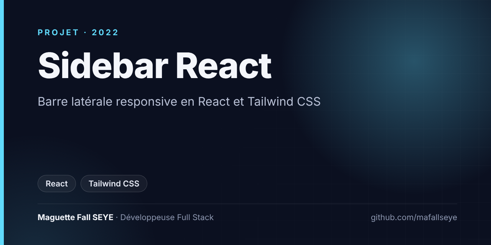
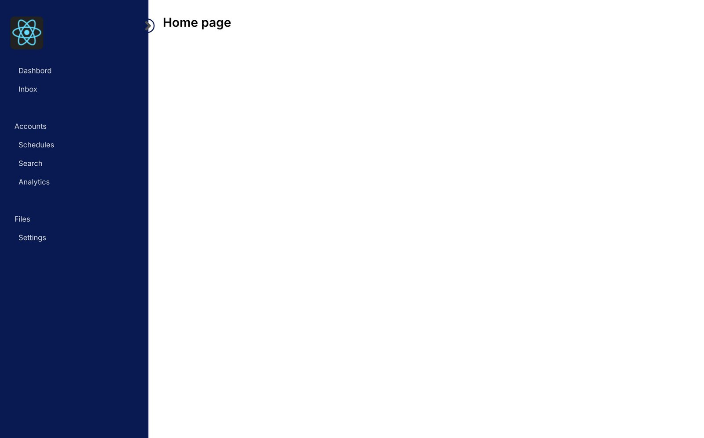

<p align="center"></p>

# Sidebar React

Composant de barre latérale responsive.

## Aperçu

<p align="center"><br><em>Barre latérale</em></p>

## Fonctionnalités

- Barre latérale repliable
- Mise en page responsive

## Technologies

React · Tailwind CSS

## Lancer le projet

Prérequis : Node.js 16 ou plus.

```bash
git clone https://github.com/mafallseye/sidebar-react.git
cd sidebar-react
npm install
npm start
```

> Projet réalisé en 2022 pendant ma formation. Il est conservé ici comme trace de mon parcours.

## Auteure

**Maguette Fall SEYE** — Développeuse Full Stack, Dakar (Sénégal) · [github.com/mafallseye](https://github.com/mafallseye)
